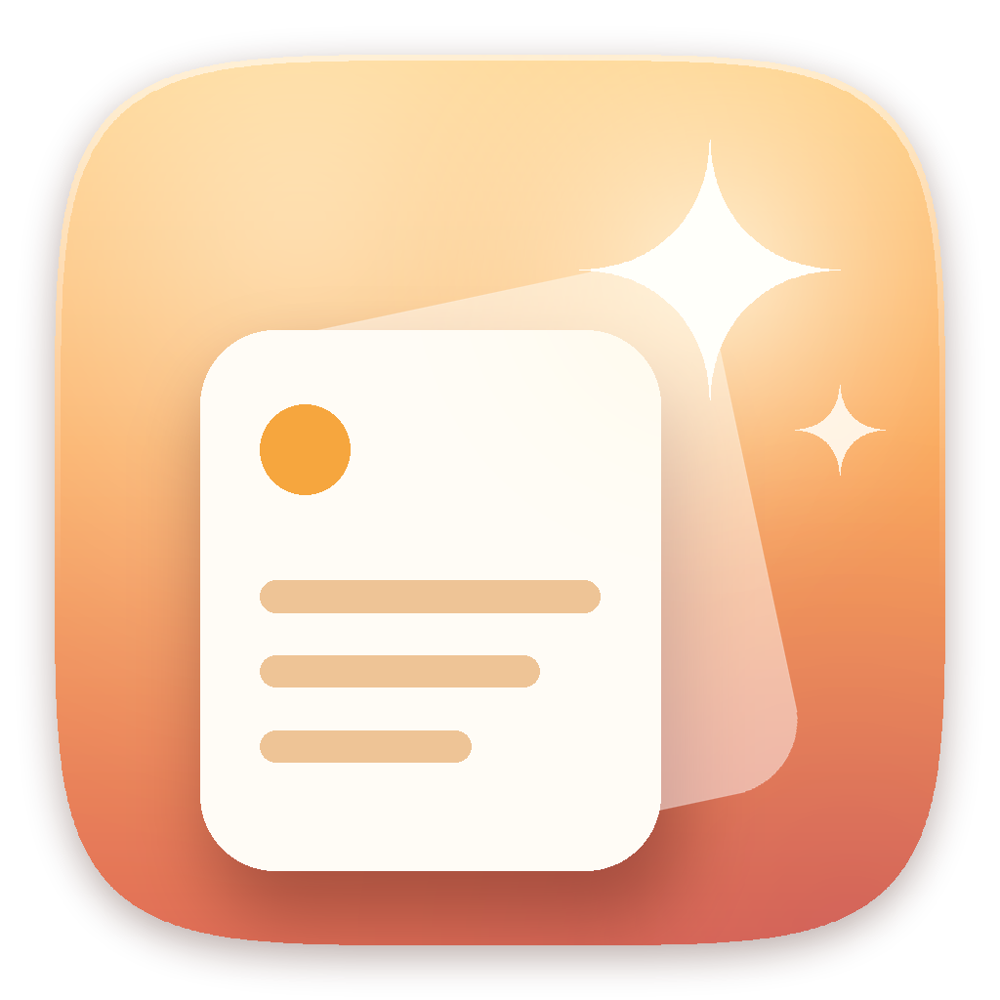

  

<h1 align="center">Glean 拾光</h1>

拾起你复制过的每一束光。 Windows 上的剪切板历史与常用文件夹工具,风格参考 macOS 的 Paste。

作者:<a href="https://github.com/berlin955">Berlin955</a>

---

## 功能

**剪切板**
- 自动记录复制过的文字、图片、文件,`Win + V` 随时呼出
- 卡片(屏幕底部)和列表两种界面,浅色 / 深色 / 跟随系统,毛玻璃背景
- 自定义分类、置顶、重命名、拖拽排序、拖进分类、拖到其他程序
- 空格快速预览,`Ctrl + 1~9` 直接粘贴,"粘贴为…"纯文本、大小写转换等
- 识别链接、邮箱、颜色值、路径,记录内容来自哪个程序
- 忽略密码管理器等应用,可设置保留条数和自动清理

**文件夹**
- 把常用文件夹拖进面板,网格 / 列表浏览,缩略图有缓存,打开很快
- 空格预览图片、文本、视频、PDF 等,文件可以直接拖到聊天窗口、网页、PS 里

**自动更新**
- 每天在后台检查一次新版本,一键下载安装,历史记录和设置都保留

## 安装

到 [Releases](../../releases) 下载最新的 `Glean-Setup.exe`,双击安装。不需要管理员权限,Windows 10 / 11 自带运行环境。

> 安装包没有数字签名,Windows 可能提示"已保护你的电脑",点"更多信息 → 仍要运行"即可。

## 自己编译

不需要安装任何开发工具,用 Windows 自带的编译器:

- 双击 `build.bat`:编译并运行 `Glean.exe`
- 双击 `make-setup.bat`:生成安装包 `Glean-Setup.exe`

## 隐私

剪切板历史只保存在你自己的电脑上(`%APPDATA%\Glean`)。软件只会在检查更新时访问 GitHub,不会上传任何内容。
